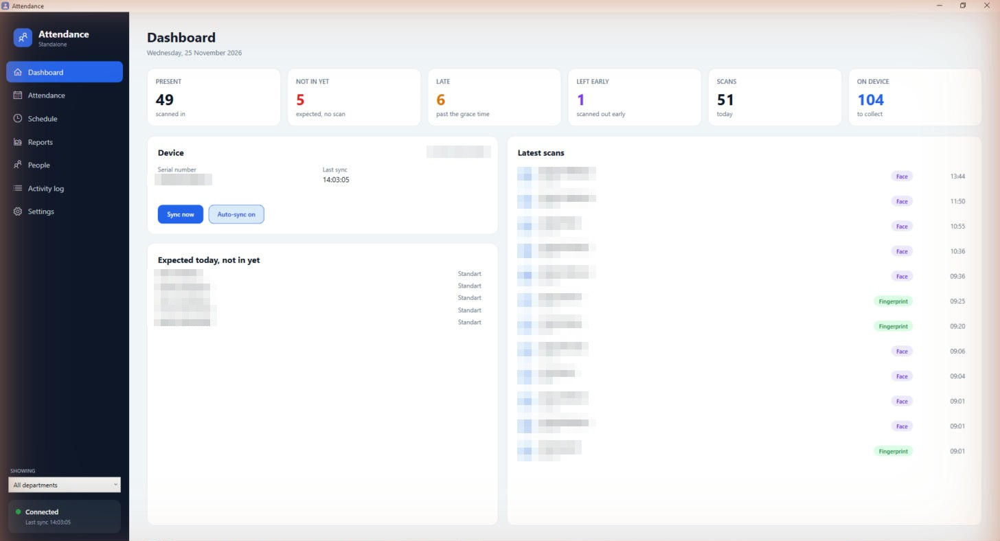
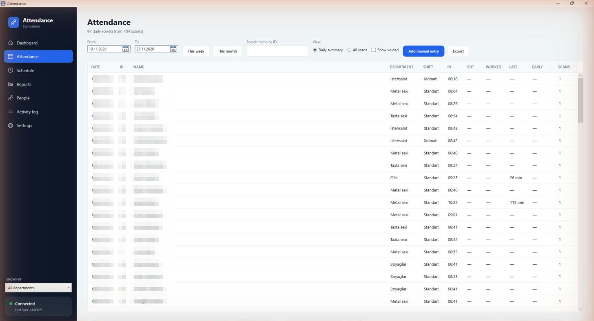
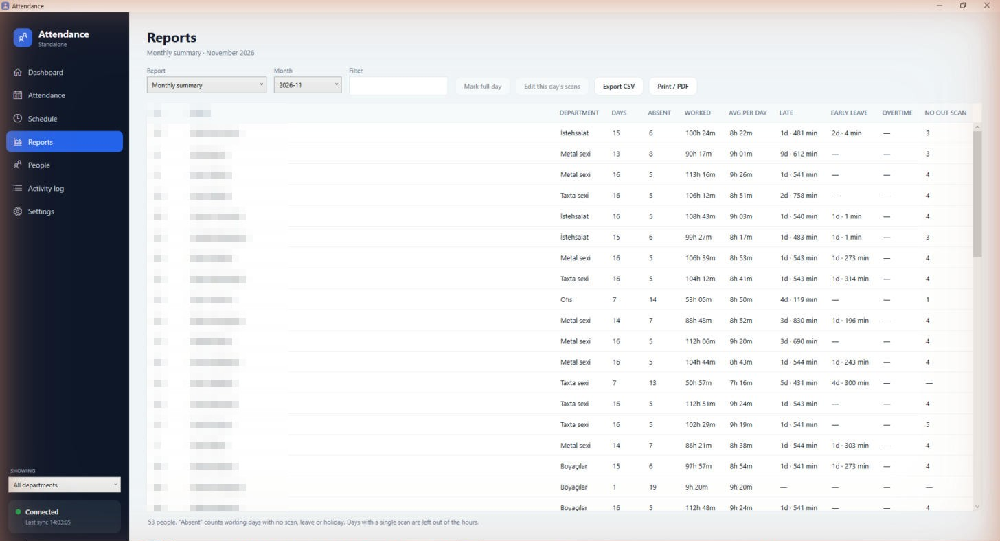
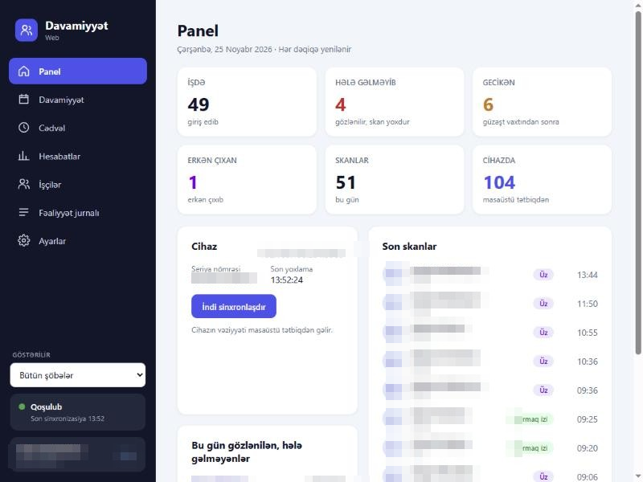
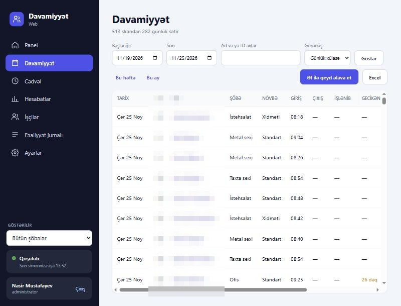
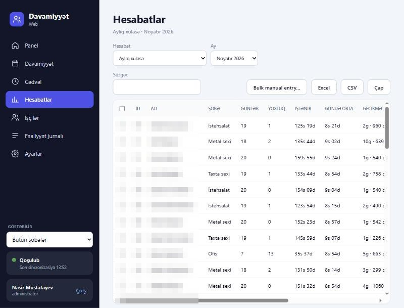
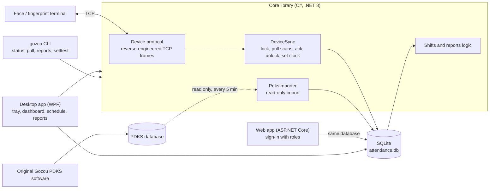

# Attendance (Gozcu PDKS standalone)

An independent attendance system for a face and fingerprint terminal, talking to it directly instead of through
the vendor's own software.

## Why I built it

The vendor software (Gozcu PDKS) clears scans off the device as it reads them and locks the company into its own
program: no API, no export it can share, nothing else can read the terminal without racing it for the same data.
So I reverse-engineered the terminal's own protocol and built a system that talks to it directly, keeps its own
database, and gives the company a desktop app, a web app with roles, and a CLI — independent of the vendor's
software, able to run alongside it or replace it.

## How I built it with AI

I captured real traffic between the vendor app and the terminal, then used Claude Code to help decode the frames
and write the protocol code from that capture. Nothing was trusted until it worked against the real device:
`gozcu selftest` replays the captured bytes through the code and checks the result matches, so a change to the
frame handling is caught before it ever reaches the terminal.

*Not affiliated with Gozcu. Built for interoperability with a device we own. No vendor code is included.*

## Projects

| Folder | What it is |
|---|---|
| `src/Core` | Device protocol and sync, SQLite storage, PDKS import, shift and report logic, English/Azerbaijani text |
| `src/App` | Windows desktop app (WPF): collects scans from the device, dashboard, attendance, schedule, reports, people |
| `src/Web` | Web app (ASP.NET Core): the same screens in a browser, sign-in with roles, shares the desktop app's database |
| `src/Cli` | `gozcu` command-line tool: status, pull, reports, PDKS import, sync requests, web users, database check |

## Build

Requires the .NET 8 SDK.

```powershell
dotnet build src/App
dotnet publish src/App -c Release -r win-x64 --self-contained true -p:PublishSingleFile=true -o dist
dotnet publish src/Web -c Release -r win-x64 --self-contained true -p:PublishSingleFile=true -o dist/web
```

`dotnet run --project src/Cli -- selftest` checks the device protocol code against captured traffic.

## Running

- The desktop app stores its data in `%LOCALAPPDATA%\GozcuStandalone` (`attendance.db`, `settings.json`, daily backups).
- Web app setup, running it as a Windows service and reaching it from other PCs: see [WEB-SETUP.md](WEB-SETUP.md).
- `setup-web-service.ps1` (run as administrator) installs the web app as a service, opens port 5080 on private
  networks and stops the PC from sleeping.

Reading from the device never removes scans from it unless "take over from the original software" is turned on,
so PDKS can keep running alongside. The PDKS database is only ever read.

## Screenshots

<!-- Employee names and IDs are blurred. -->
Desktop app (WPF):

| Dashboard | Attendance | Reports |
|---|---|---|
|  |  |  |

Web app (same data, in a browser):

| Dashboard | Attendance | Reports |
|---|---|---|
|  |  |  |

## How it works



**The protocol.** The terminal's wire format was worked out from packet captures of the vendor app. Each frame ends
with a 16-bit little-endian checksum of the bytes before it. A session locks the terminal, reads the pending scans,
acknowledges them and always ends with an unlock, because the terminal ignores scans while it is locked.

**Safe by default.** Reading from the device does not remove scans unless "take over from the original software" is
on, so PDKS can keep running alongside. The PDKS database is only ever read.

**Testing.** `gozcu selftest` checks the protocol code against captured real traffic, so a change to the frame
handling is caught before it reaches the device.
